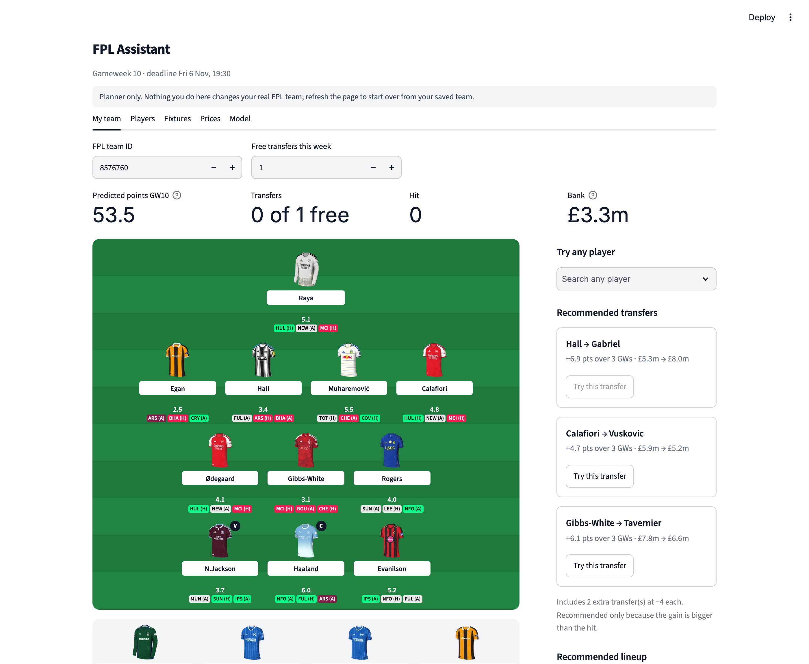

# FPL Assistant

[](https://github.com/PellePico/fpl-assistant/actions/workflows/tests.yml)


[](LICENSE)

A Fantasy Premier League planner. It loads your team live from FPL, predicts every player's points with a
machine learning model, and recommends transfers and a captain, which you can then try out in a sandbox
before making any moves in the real game.



## Features

- **Your team on a pitch.** Loads your real squad, captain and bench from your FPL team ID. Each player shows
  their predicted points and next three fixtures in FPL's difficulty colours.
- **Sandbox.** Make transfers, substitutions and captain changes. Bank, free transfers, −4 hits and predicted
  points update as you go. It's read-only towards FPL, so your real team is never touched.
- **Try any player.** Search all 600+ players, compare them with yours in that position and drop them into your team.
- **Recommendations.** An optimizer finds the best transfers (taking a hit only when it pays off) and the best
  lineup and captain.
- **Player details.** Fixture run with predicted points per gameweek, and a breakdown of where the points come from
  ("0.28 expected goals × 5 pts = 1.4").
- **Fixtures.** Double and blank gameweeks, plus a difficulty table for all 20 teams.
- **Prices.** Risers, fallers and transfer trends.
- **Model transparency.** A backtest of every prediction method on gameweeks the model never saw.

## How it works

```
FPL API (live) ──► features ──► ML model ──► predicted points per player per gameweek
                                                     │
                     your team ──► optimizer (integer linear programming) ──► transfers, XI, captain
```

1. **Data.** `fpl_data.py` reads the public FPL API: players, fixtures and your team. No login, no API key.
2. **Features.** `features.py` turns each player's season so far into per-90 rates (xG, xA, bonus, defensive
   actions, …) plus form and fixture difficulty. **The same function builds features for training and for live
   predictions**, and a test checks the two match exactly. That prevents training/serving skew.
3. **Model.** `train.py` fits a gradient boosting regressor on every player-match of the 2025-26 season
   (27,646 rows). Predictions are multiplied by each player's availability from FPL's injury news.
4. **Explanation.** `points_model.py` is a transparent formula (expected goals × points per goal, Poisson
   clean-sheet chance, …). The app uses it to explain predictions in plain numbers.
5. **Optimization.** `optimizer.py` uses PuLP to pick the provably best squad under every FPL rule: budget,
   2/5/5/3 positions, max 3 per club, valid formations, and a transfer limit with −4 hits.

## Backtest

One gameweek ahead on 2026-27 GW3–6, which the model never trained on (2,647 player-gameweeks):

| Method | Average error (pts) | Average error, players who played |
|---|---|---|
| **ML model (used in the app)** | **1.149** | **1.998** |
| Simple formula | 1.188 | 2.111 |
| Average of last 5 gameweeks | 1.252 | 2.282 |
| Predict 0 for everyone | 1.411 | 3.035 |
| FPL's official prediction* | 0.997 | 1.983 |

\*From a public archive saved *after* each gameweek, so it may include information from after kick-off, such as
late injury news. That isn't a fair comparison. Among the fair methods, the ML model is the most accurate, though
only by about 3%, and four early-season gameweeks is a small test.

## Run it

```bash
git clone https://github.com/PellePico/fpl-assistant.git
cd fpl-assistant
./run.sh            # first run sets everything up, then opens http://localhost:8501
```

Data is fetched live from FPL every time you open the app (cached for an hour), so it's always up to date.

```bash
.venv/bin/pytest                 # 14 tests, run on every push by GitHub Actions
.venv/bin/python train.py        # retrain the model
.venv/bin/python backtest.py     # re-run the backtest
```

## Project structure

```
├── app.py               Streamlit app
├── fpl_data.py          FPL API client
├── features.py          feature engineering (shared by training and live)
├── train.py             model training
├── ml_model.py          live predictions
├── points_model.py      explainable points formula
├── optimizer.py         integer linear programming (PuLP)
├── backtest.py          model evaluation
├── models/              trained model + backtest results
├── tests/               pytest suite
└── .github/workflows/   CI
```

## Roadmap

- Retrain each week with this season's data, and backtest over more gameweeks
- A dedicated minutes model; rotation is the biggest source of error
- Real selling prices and chips (wildcard, bench boost, triple captain)

## Credits

- Data: the official [Fantasy Premier League](https://fantasy.premierleague.com) API (unofficial use) and the
  [vaastav/Fantasy-Premier-League](https://github.com/vaastav/Fantasy-Premier-League) archive for training
- Modelling approach inspired by [OpenFPL](https://github.com/daniegr/OpenFPL)
  ([paper](https://arxiv.org/abs/2508.09992))
- Built with [Claude Code](https://claude.com/claude-code)

Not affiliated with the Premier League or Fantasy Premier League.
